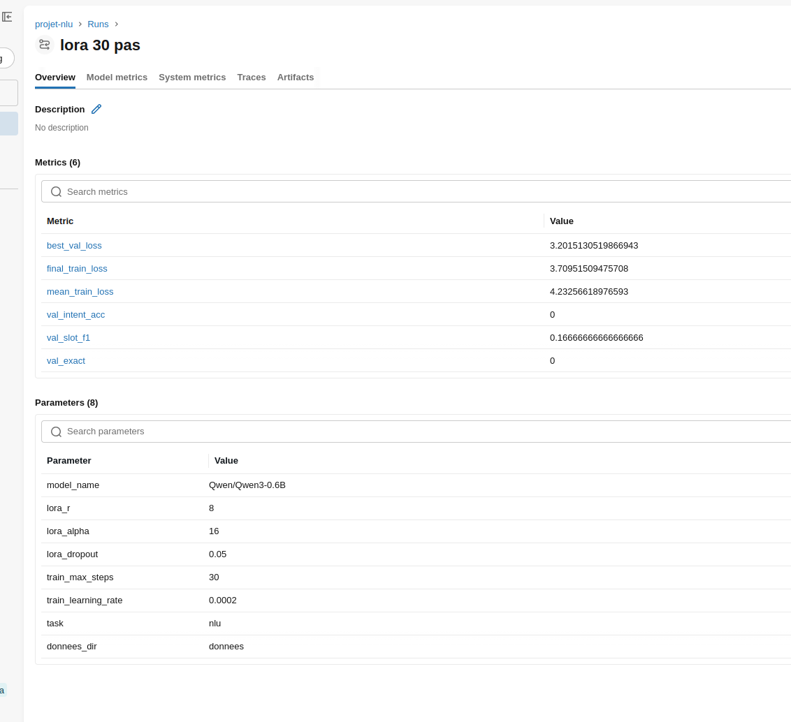
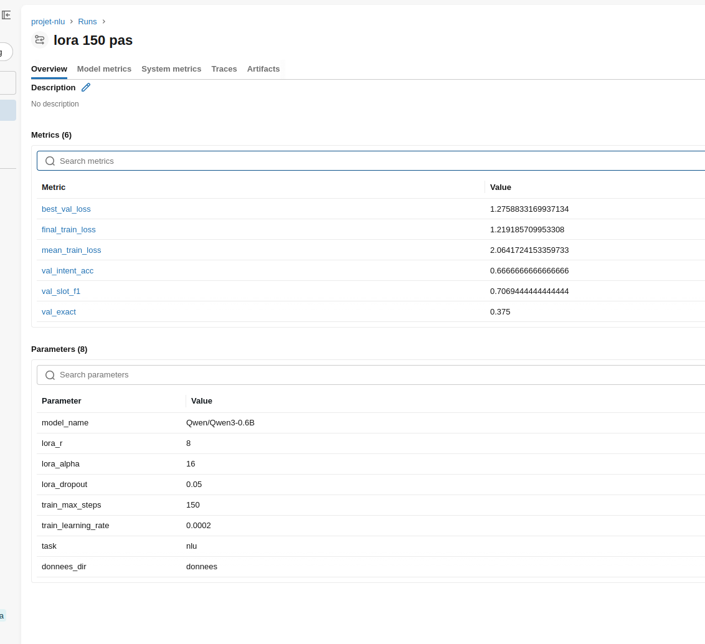
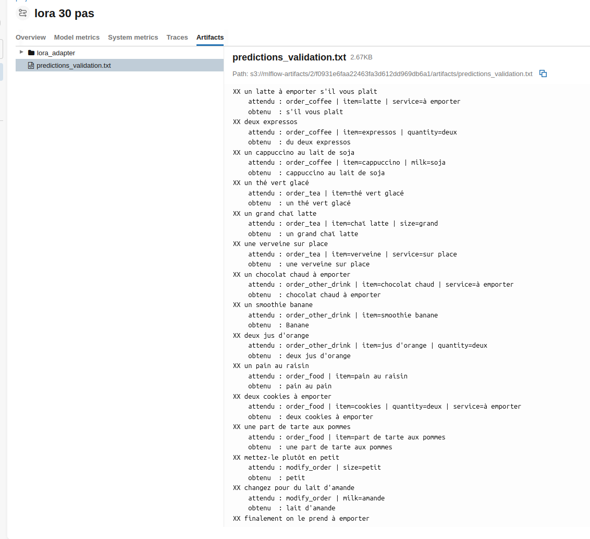
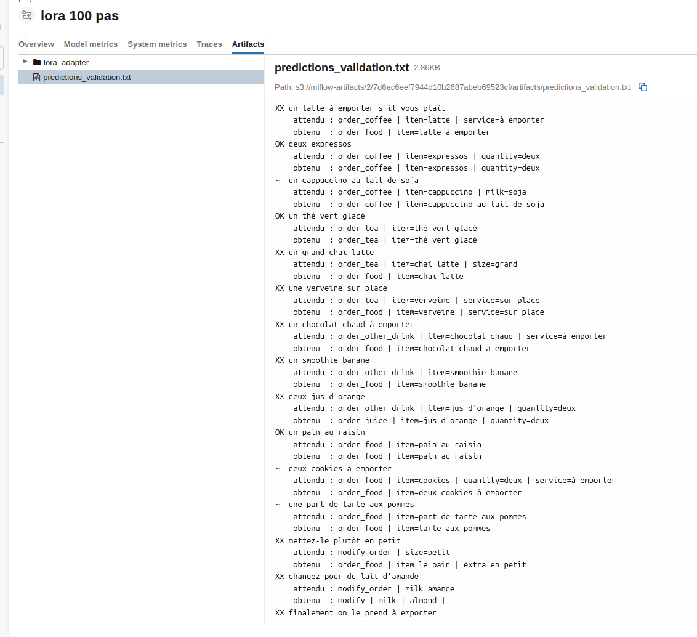

# Coffee shop NLU

LoRA fine-tuning of Qwen3-0.6B to understand an order placed at a coffee shop counter (in French).

```
un grand latte avoine à emporter
→ order_coffee | item=latte | size=grand | milk=avoine | service=à emporter

c'est combien le cookie
→ menu_question | item=cookie
```

8 intents, 6 slots, 168 handwritten sentences (120 train / 24 validation / 24 test).

## Data


Conventions, tuning, results and limits: [donnees/NOTES.md](donnees/NOTES.md).

## Tuning on the validation set

| max_steps | val_intent_acc | val_exact |
| --- | --- | --- |
| 30 | 0 % | 0 % |
| 60 | 8 % | 8 % |
| 100 | 42 % | 25 % |
| 150 | 67 % | 38 % |

| 30 steps | 150 steps |
| --- | --- |
|  |  |

Validation predictions at 30 steps (the model repeats the input) and at 100 steps (wrong intents, invented labels):




## Run

```bash
make setup
uv sync
make valider
make run      # TRAIN_MAX_STEPS in .env
make juger
make livrer
```

Try the deliverable:

```bash
uv run python evaluer_livrable.py livrables/livrable_groupe-coffee-shop.zip --demo
```

Base code provided in class (NLU project exercise, TP3).
