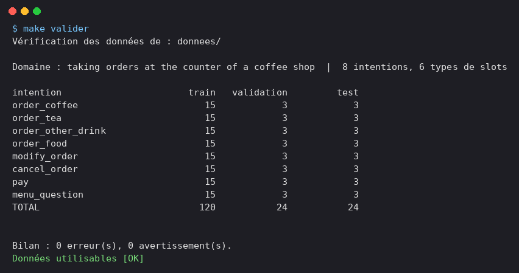

# Coffee shop NLU

LoRA fine-tuning of Qwen3-0.6B to understand an order placed at a coffee shop counter (in French).

```
un grand latte avoine à emporter
→ order_coffee | item=latte | size=grand | milk=avoine | service=à emporter

c'est combien le cookie
→ menu_question | item=cookie
```

8 intents, 6 slots, 168 handwritten sentences (120 train / 24 validation / 24 test).

## Data



Conventions, tuning, results and limits: [donnees/NOTES.md](donnees/NOTES.md).

## Run

```bash
make setup
uv sync
make valider
make run      # TRAIN_MAX_STEPS in .env
make juger
make livrer
```

Try the deliverable:

```bash
uv run python evaluer_livrable.py livrables/livrable_groupe-coffee-shop.zip --demo
```

Base code provided in class (NLU project exercise, TP3).
